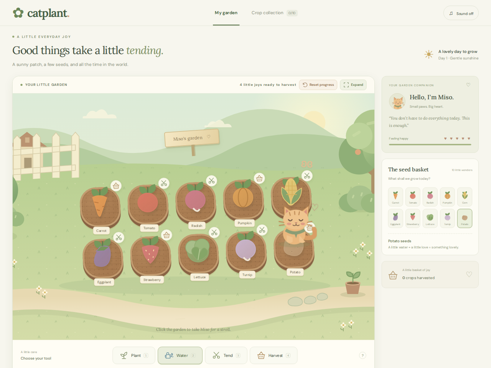

# Catplant

[](https://github.com/SkyOne771/catplant/actions/workflows/ci.yml)
[](LICENSE)

**A small garden, a friendly cat, and a little everyday joy.**

Catplant is a cozy browser game built with JavaScript, SVG, CSS, and Vite. Plant and care for ten crops with Miso, an animated cat who walks to wherever you click. There are no timers, losing conditions, accounts, or in-game purchases.

**[Play the live game](https://vps-bbba68b4.vps.ovh.ca/catplant/)** · **[Architecture](docs/ARCHITECTURE.md)** · **[Deployment](docs/DEPLOYMENT.md)** · **[Testing](docs/TESTING.md)**



## What you can do

- Grow carrots, tomatoes, radishes, pumpkins, corn, eggplants, strawberries, lettuce, turnips, and potatoes across ten patches.
- Follow a simple **plant → water → tend → harvest** cycle. Tool icons show what each crop needs next.
- Click or tap the garden to move Miso. A separate SVG walking rig animates four legs, head movement, tail sway, and fading paw prints.
- Enjoy encouraging messages, action effects, and optional Web Audio chimes.
- Collect all ten crops and continue your garden after refreshing; progress saves in your browser.
- Expand the play area, use keyboard shortcuts, or play on a phone. Mobile crop details stay below the garden to keep Miso visible.
- Reset progress through a confirmation dialog.

## Run locally

Requires **Node.js 22 or later** and npm.

```sh
git clone https://github.com/SkyOne771/catplant.git
cd catplant
npm ci
npm run dev
```

Open the local URL printed by Vite. For a production build:

```sh
npm run build
npm run preview
```

The deployable files are in `dist/`. The game is a static application and needs no database, API keys, or application server.

## Controls

| Action               | Control                                                 |
| -------------------- | ------------------------------------------------------- |
| Choose a crop        | Click or tap a seed in the basket                       |
| Select a tool        | Toolbar or keys **1–4** for Plant, Water, Tend, Harvest |
| Care for a crop      | Select its required tool, then click or tap its patch   |
| Move Miso            | Click or tap a point in the garden                      |
| See crop details     | Hover or focus on desktop; tap on mobile                |
| Expand the garden    | **Expand** in the garden header                         |
| Leave expanded view  | **Back** or **Escape**                                  |
| Enable chimes        | Sound button in the page header                         |
| Clear saved progress | **Reset progress**, then confirm                        |

## Technical overview

| Area                       | Implementation                                                                  |
| -------------------------- | ------------------------------------------------------------------------------- |
| UI and game logic          | Vanilla JavaScript and DOM events; no frontend framework                        |
| Illustration and animation | SVG scenery and character rig, CSS keyframes, timed movement                    |
| Persistence                | Versioned `localStorage` save on the current browser and origin                 |
| Sound                      | Web Audio oscillators, enabled by the player                                    |
| Build                      | Vite with configurable asset base paths                                         |
| Hosting                    | Static files behind Caddy, or a multi-stage Docker build with Nginx             |
| Verification               | Playwright journeys on Chromium, Firefox, and a mobile viewport; GitHub Actions |

See [Architecture](docs/ARCHITECTURE.md) for state transitions, file responsibilities, and tradeoffs.

## Check your changes

```sh
npm ci
npx playwright install --with-deps chromium firefox
npm run check
```

`npm run check` checks formatting, builds the production site under `/catplant/`, and runs the browser tests. See [Testing](docs/TESTING.md) for coverage and limitations.

## Deploy

Serve `dist/` with a static host, or run:

```sh
docker compose up -d --build
```

The container binds to `127.0.0.1:8080` by default for use behind an HTTPS proxy. [Deployment](docs/DEPLOYMENT.md) covers root and subpath hosting, Docker, Caddy releases, updates, and rollback.

## Privacy and limitations

Progress stays on the current device and browser profile. There is no account system, cloud sync, analytics, or offline service worker. Clearing browser storage, using private browsing, or changing the game’s origin can make an existing save unavailable. The reset dialog deletes the save only after confirmation.

Google Fonts is the only external runtime service; system fonts provide a fallback. Audio starts only after a player enables it. Animations honor `prefers-reduced-motion`. Semantic buttons, focus indicators, labels, and keyboard shortcuts are provided, but the game has not received a formal accessibility audit.

The browser tests cover core interactions; the Docker image has not been verified in this development environment. Locally modified save data is not treated as trusted input for security-sensitive features, and there are no such features in this game.

## Portfolio summary

> Built and deployed a responsive browser gardening game using JavaScript, SVG, CSS, and Vite. Implemented a ten-crop care cycle, persistent local progress, an animated four-leg character rig, mobile-specific interaction details, and cross-browser end-to-end tests with GitHub Actions.

See [Portfolio and CV copy](docs/PORTFOLIO.md) for a project entry, optional bullets, and a demo sequence.

This repository was developed iteratively with AI assistance. The summary describes the implemented project; it does not imply production user counts, performance benchmarks, or that the code was written without assistance.

## Contributing and license

See [CONTRIBUTING.md](CONTRIBUTING.md) for the development workflow. Code and repository illustrations are released under the [MIT License](LICENSE). Externally loaded fonts retain their own licenses.
